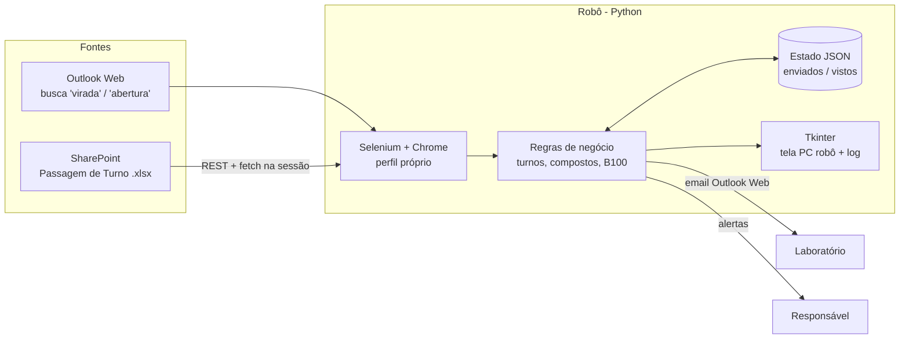

# Robô de Pedido de Laudo

Automação em Python que **solicita laudos de qualidade ao laboratório só quando há um motivo operacional**, num terminal de distribuição de combustíveis que opera 24h.

> **Resultado:** cerca de **R$ 20 mil por mês de saving**, porque o terminal deixou de pagar laudos que não precisava.


---

## O problema

Antes, o laboratório gerava **laudo de todos os tanques de Biodiesel B100 e de Etanol Anidro usados nos compostos**, sem que ninguém tivesse pedido. Cada laudo tem custo, e a maior parte deles não era necessária. O controle era manual: dependia de alguém acompanhar emails e planilhas em todos os turnos e lembrar de pedir o laudo certo.

## A solução

Um robô roda num PC dedicado, sem parar. Ele lê as mesmas fontes que a operação já usa:

- **Outlook Web**: emails de virada de tanque e de abertura de tanques
- **SharePoint / Excel**: a planilha de Passagem de Turno dos supervisores

Com isso, ele pede ao laboratório **somente os laudos necessários**, já com o texto pronto e os tanques certos. Ninguém precisa digitar nada.

| | Antes | Depois |
|---|---|---|
| Quais laudos | Todos os tanques dos compostos, sem solicitação | Só os tanques que mudaram ou que a regra exige |
| Quem pede | Ninguém (era automático no laboratório) ou alguém manualmente | O robô, 24h, em até ~2–3 min do fato |
| Duplicidade | Comum | Bloqueada: cada pedido sai uma única vez |
| Rastreabilidade | Email solto | Histórico na tela + log + estado em JSON |
| Custo | Alto | **~R$ 20 mil/mês a menos** |

---

## Gatilhos (regras de negócio)

| # | Gatilho | Fonte | O que é pedido |
|---|---|---|---|
| 1 | **Virada de tanque do pool** (email "Virada de OD S10 p/ TQ 09 às 04h30") | Outlook, busca "virada" | Tanque do pool + tanque do componente em expedição (S10/S500 → B100, Gasolina → Anidro) |
| 2 | **Troca do tanque de B100 ou Anidro** em expedição | Passagem de Turno (coluna EXPEDINDO do turno atual) | Tanque novo + último tanque do pool de cada produto que usa o componente |
| 3 | **Abertura de tanques** com tanque de S10/S500/Gasolina diferente do dia anterior | Email "ABERTURA DE TANQUES" (23:25–01:00, inclusive ERRATA) | Tanque novo do pool + componente |
| 4 | **Etanol Hidratado amostrado** | Seção LAUDOS da Passagem de Turno | Laudo do tanque ("a amostra já está na caixinha") |
| 5 | **Semanal S10 B30** | Agenda: segunda, 00:30–01:00 | Último tanque de S10 do pool + B100 em expedição |
| — | **Aviso:** abertura não recebida até 00:15 | — | Email de alerta para o responsável |

Detalhes que valem para todos os gatilhos:
- **Turnos:** 3º (00:00–07:30), 1º (07:30–15:30) e 2º (15:30–24:00). O robô lê a coluna do turno atual. Se ela ainda estiver vazia, usa a do turno anterior, e nunca lê um turno que ainda não começou.
- **B100:** se a passagem citar 103/105, usa só esses ("206/105" → 105). Se não citar, usa o que estiver anotado (203/206).
- **Planilha do dia e do mês:** abre sozinha a pasta do mês (`10 - Outubro`) e a aba do dia (`21`), e confere a data dentro da planilha.

## Proteções

- **Só emails novos:** quando liga, o robô marca como visto tudo o que já está no Outlook. Ele também confere o horário de chegada do email e ignora respostas ou encaminhamentos de viradas antigas.
- **Nunca duplica:** a chave de cada pedido é tanque + horário, ou tanque + data, e fica persistida em JSON.
- **Nunca envia pedido incompleto:** se faltar o tanque do componente, segura o pedido, avisa na tela e tenta de novo a cada 2 min.
- **Modo teste:** com um clique, os emails vão para um responsável em vez do laboratório.
- **Rótulo de confidencialidade:** quando o Outlook exige, ele escolhe "Público" sozinho.
- **Resiliência:** se o Chrome travar, ele reabre, limpa as travas do perfil, impede a suspensão do Windows e não deixa abrir duas instâncias.
- **Tela "PC robô":** fica em tela cheia com o status, o último pedido e os alertas.

---

## Arquitetura



- **Selenium** controla um Chrome com perfil próprio, e as sessões do Outlook e do SharePoint ficam salvas.
- O **SharePoint** é lido pela API REST, chamada com `fetch` dentro da própria sessão do navegador. Assim não é preciso guardar senha nem token: a pasta é listada, a planilha é baixada e o **openpyxl** a interpreta.
- Os emails são escritos no Outlook Web: o robô preenche o destinatário, o assunto e o corpo, envia e confirma que o rascunho fechou.
- A interface fica numa thread de UI, e o monitor roda numa thread separada; as duas conversam por `queue`.

## Tecnologias

Python 3.13 · Selenium · openpyxl · Tkinter · SharePoint REST API · Outlook Web · pytest

---

## Como rodar

```bash
pip install -r requirements.txt
copy config.example.json config.json   # preencha emails e caminhos do SharePoint
iniciar.bat                             # ou: python monitor_laudo.py
```

Na primeira execução, faça login no Outlook e no SharePoint no Chrome que o robô abrir. O perfil fica salvo, então não é preciso repetir o login.

Para o robô voltar sozinho depois que o PC reiniciar, coloque um atalho do `iniciar.bat` em `shell:startup`.

### Configuração (`config.json`)

| Chave | Para quê |
|---|---|
| `EMAIL_LABORATORIO`, `EMAIL_CC` | Destino dos pedidos em produção |
| `EMAIL_TESTE`, `EMAIL_AVISO_ABERTURA`, `MODO_TESTE` | Modo teste e alertas |
| `SP_SITE`, `SP_RAIZ`, `NOME_PLANILHA`, `SP_ARQUIVO_ID` | Onde fica a Passagem de Turno |
| `TANQUES_BASE`, `B100_PREFERIDOS`, `TANQUES_HIDRATADO` | Tanques da instalação |

O `config.json` não é versionado (está no `.gitignore`).

## Testes

As regras de negócio têm testes automatizados. Eles não precisam de navegador, Outlook nem SharePoint:

```bash
pytest -q
```

Os testes cobrem a leitura do assunto da virada, o filtro de emails que não são virada, a data da virada, os turnos, a regra do B100, a planilha de passagem (turno atual e turno futuro), a seção LAUDOS, a abertura de tanques, a troca de tanque sem duplicar, o bloqueio de pedido incompleto e a janela do pedido semanal.

## Estrutura

```
monitor_laudo.py        # robô (monitor + regras + interface)
config.example.json     # modelo de configuração
iniciar.bat             # instala dependências e abre o robô
tests/                  # testes das regras de negócio
docs/tela_robo.png      # tela do PC robô
```

---

Feito por **Caique Andrade**, assistente de operações e desenvolvedor de automações (Python/RPA) · [github.com/CAIQUE4NDRADE](https://github.com/CAIQUE4NDRADE)

> Os nomes de empresas, endereços de email, caminhos e identificadores internos foram removidos ou trocados por valores de exemplo.
